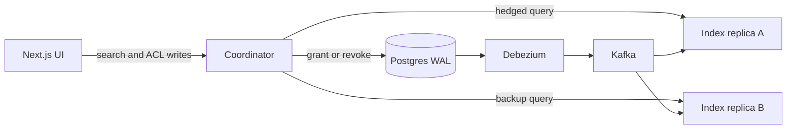
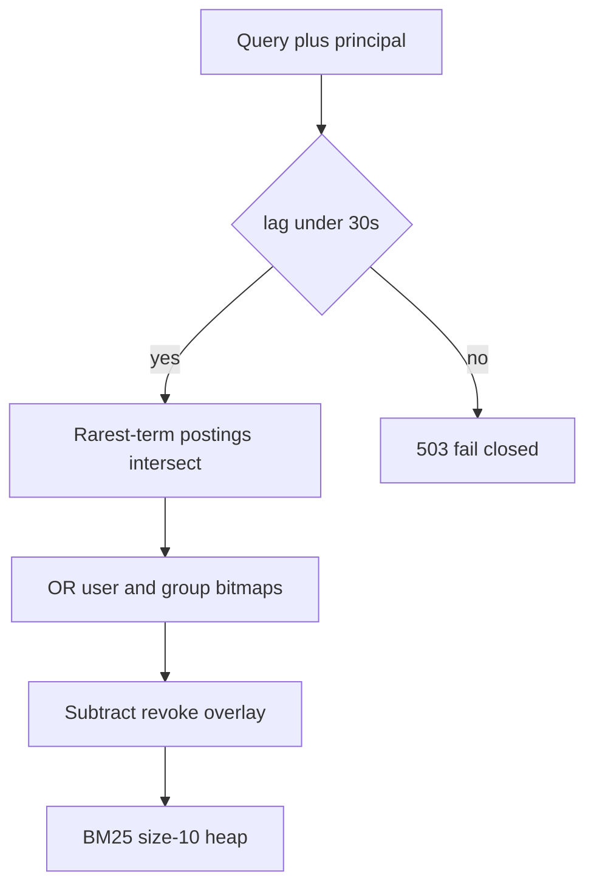

# Multi-Tenant Document Search: Master Execution Plan

Build one service that, for a tenant-scoped user and a keyword query, returns the 10 readable documents with the best BM25 scores. A document with no allow-grant is invisible. A grant, revoke, or group-membership change committed in Postgres is reflected in search within 30 seconds. Under normal load, 99% of queries finish within 100ms server time even when one index replica is degraded.

The phase-1 SQL implementation is never deleted. It remains the visibility authority every later phase calls before it returns hits.

## 1. Production Tech Stack and Justification

### Language and runtime: Java 21, Gradle, module-per-process

Java 21 is the implementation language because the three hard parts of this system — compressed bitmaps, a Kafka consumer, and a Debezium pipeline — already share the JVM as their production home. RoaringBitmap, the Apache Kafka client, and Debezium’s Postgres connector are native to that runtime, so the index process, the applier, and the change-data-capture connector sit in one memory model.

The Java Memory Model is part of the design, not an accident. Index publication is single-writer, many-readers: the applier mutates a private copy, then stores an immutable `IndexSnapshot` into a `volatile` field. A reader that loads that field happens-before every write the applier did before the release. Roaring bitmaps are not safe for concurrent mutation, so a bitmap is swapped into a `ConcurrentHashMap` only after it is fully built. Query threads never take a lock on the hot path.

Garbage collection is sized for the latency budget. Generational ZGC on Java 21 keeps stop-the-world pauses well under the 100ms SLO, but a concurrent collector does not forgive an allocating query path: allocation rate still burns CPU and fills the heap. Scoring therefore uses primitive arrays, a reused size-10 heap, and roaring containers instead of `HashSet<Long>`. Virtual threads are used for the phase-1 JDBC oracle and for Kafka polling. The phase-4 scorer stays on a small platform-thread pool. Virtual threads do not speed a CPU-bound intersection, and an unbounded virtual-thread fanout would oversubscribe the same cores the scorer needs.

HTTP at the edge is JSON so the UI and `curl` can read responses. Replica fanout is JSON as well, until a benchmark shows encoding of a 10-hit response above 5ms. Only then do you add a length-prefixed binary frame, in its own commit.

Processes, each one a Spring Boot application except the page:

- `search-oracle` — phase-1 SQL path, kept as the visibility authority.
- `search-index` — in-memory inverted index, ACL bitmaps, Kafka applier. Two copies in compose.
- `search-coordinator` — auth-mode gate, hedging, coalescing, `Server-Timing`.
- `web` — Next.js UI.

Spring Boot publishes the HTTP API: Tomcat, Jackson, virtual request threads, and the `/v1` controllers. It does not replace the visibility SQL, the volatile snapshot, the hedge timer, or the Kafka offset commit. Those stay classes the controllers call. There is no JPA and no `@KafkaListener`.

### Inverted index: hand-built, Lucene-shaped

The index is custom code with Lucene’s segment ideas, not Elasticsearch. Elasticsearch document-level security is a post-filter. Post-filtering is the phase-1 lesson; shipping it as the product would make the p99 SLO depend on how rare the user’s grants are.

Per tenant:

- Dictionary: term → sorted postings of dense `int` doc ids plus term frequency.
- Document table: dense id → external id, title, body length, token count.
- Live-doc roaring bitmap (deletes are tombstones, ids are not recycled during a process lifetime).
- BM25 with `k1 = 1.2`, `b = 0.75`. Tie-break by doc id so the same corpus always returns the same order.
- Tokenizer: Unicode casefold and a word-boundary split. Stemming stays out of v1 so relevance diffs are explainable.

Dense integer ids are mandatory. Roaring bitmaps want 32-bit keys; UUIDs in a `HashSet` would dominate both memory and intersection time. A monotonic dictionary maps external id → int.

Query execution for a conjunction (all terms required):

1. Order terms by document frequency, rarest first.
2. Intersect sorted postings with galloping search.
3. Intersect the survivor set with the caller’s visibility bitmap as soon as that bitmap is more selective than the next term.
4. Score survivors with BM25 into a size-10 heap.

If the corpus outgrows RAM, the same interfaces gain Lucene segments (immutable postings, FST dictionary, WAND early termination). That is a later substitution, not the first design.

### System of record: PostgreSQL 16

Postgres holds tenants, users, groups, memberships, documents, and allow-grants. It is the only writable store. Search nodes never accept a permission write except by replaying the log.

MVCC matters for the freshness proof. A grant that inserts an ACL row in the same transaction as a document insert becomes visible at one LSN. Logical decoding emits that transaction in commit order. The applier applies it as one unit, so a document never becomes searchable in the gap before its grant, and a revoke never lags behind the content it protects because of a torn multi-table write.

Phase 1 queries are deliberately naive: `body ILIKE` plus `EXISTS` on allow-grants for the user or any current group, always constrained by `tenant_id`. That plan sequential-scans. The miss against 100ms is the baseline the later commits have to beat.

Schema sketch:

- `tenants`, `users(tenant_id, user_id)`, `groups`, `group_memberships`
- `documents(tenant_id, doc_id, title, body, updated_at)`
- `acl_entries(tenant_id, doc_id, principal_type, principal_id)` with principal type `USER` or `GROUP`
- Unique constraint on the ACL key so grant is idempotent

Default deny: visibility is the existence of an allow row. There is no deny-override in v1. Cross-tenant access is impossible because every bitmap, posting list, and SQL predicate is tenant-partitioned. A principal id from tenant A is not a key in tenant B’s map.

### Change stream: Debezium Postgres connector and Kafka in KRaft mode

Debezium reads the write-ahead log through a logical replication slot. The search path does not poll tables. Polling would either miss the 30 second bound under load or hammer Postgres on the same budget as queries.

Topic design:

- One topic, `search.changes`, partitioned by `tenant_id`.
- Debezium transaction metadata enabled. The applier buffers events until the transaction end marker, then applies document, ACL, and membership changes at one LSN.
- Keys are tenant-scoped. Ordering across tables is reconstructed from LSN, not assumed from per-table topics.

Delivery is at-least-once. The applier is idempotent: each snapshot stores `appliedLsn`, and an event at or below that LSN is a no-op. Offset commit happens after the volatile snapshot publish, never before. A crash replays; it does not skip a revoke.

Kafka runs in KRaft mode so the demo has no ZooKeeper. Three brokers are unnecessary for a single-node compose file; one broker plus `acks=all` and a replication factor of 1 is the local stand-in, and the applier code still treats the log as replayable.

### Authorization structure: roaring bitmaps plus a revoke overlay

For each tenant the index keeps:

- `userGrants[userId] → RoaringBitmap` of doc ids
- `groupGrants[groupId] → RoaringBitmap`
- `memberships[userId] → group ids`

At query time the visible set is the OR of the user bitmap and each group bitmap, AND the live-doc bitmap. OR-ing bitmaps is linear in the compressed container size, which is the point of roaring encoding: sparse ACL sets stay in array containers, dense sets become bitsets, and the intersection with postings never materializes a Java `Integer` per doc.

This layout matches the cardinality of enterprise ACL: many documents, far fewer groups, users who inherit access through groups. It is the small-scale shape of a Zanzibar tuple check (object × relation × user) evaluated locally from a replica of the tuples, with the WAL LSN playing the role of a zookie.

Cache policy:

- Caffeine holds only permission-free data: tokenization of a query string, and parsed query plans. TTL is fine there.
- Visibility bitmaps are not TTL-cached. They are the index, updated by the applier.
- Final hit lists are not cached across users. A cache key that omits the principal is a data leak. The coordinator may coalesce identical in-flight requests; it does not reuse a completed response after the ACL epoch changes.

Revoke overlay (the correctness mechanism for the 30 second window):

- The main bitmaps can lag by seconds while a replica catches up.
- A bounded in-memory overlay records revokes and membership losses whose LSN is newer than a replica’s bitmap build, and query execution always subtracts that overlay.
- Grants may arrive late: the user fails to see a document they can read. That is a freshness miss, and the watermark gate turns it into a 503 once lag exceeds 30 seconds.
- Revokes must not arrive late in the response. Subtraction from the overlay is fail-closed. If the overlay itself cannot be read, the coordinator returns 503.

Watermark: each replica publishes `appliedLsn` and `lagMs` (now minus the commit timestamp of that LSN). If every replica reports `lagMs > 30_000`, the coordinator fails closed. Serving a stale allow-set past the SLO would satisfy latency and violate the security sentence of the spec.

Sampled shadow checks: 1% of queries, off to the side, also run the phase-1 SQL oracle and increment `acl_divergence_total` on any difference. A non-zero divergence pages the operator and flips the process to fail-closed. The shadow check is not on the latency budget.

### Coordinator, hedging, and coalescing

The coordinator is the only process the browser talks to. Index replicas are not exposed.

- Fanout is hedged, following Dean and Barroso’s tail-tolerant pattern. Send to the replica with the best EWMA latency. If it has not returned by the recent p95 of that replica (capped at 20ms), send one backup to the other replica. Return the first success. Cancel the loser so amplification stays at one extra request.
- Search is read-only and idempotent, which is the precondition for hedging. The same pattern must not be copied onto ACL writes.
- If more than a small fraction of requests (budget: 5%) need the hedge over a sliding minute, the slow replica is ejected from the primary set and kept only as a hedge target. Ejection uses latency, not errors. A replica that is “up” and slow is the failure mode in the spec.
- Coalescing (singleflight) groups identical requests already in flight on the coordinator, keyed by `(tenant, user, normalized query, aclEpoch)`. The epoch is the LSN the chosen primary had advertised. Two requests in different epochs must not share a future, or a post-revoke caller would receive a pre-revoke result.
- Internal deadline is 80ms. The remaining 20ms is client network, which the UI measures separately. A replica that exceeds its slice is abandoned even if the TCP call would eventually succeed.

### Frontend: Next.js, TypeScript, Tailwind, shadcn/ui

The UI is a demo harness and a latency instrument, not an identity provider. Stack is Next.js App Router with shadcn primitives (button, input, select, card). The browser calls the coordinator directly.

### Demo versus production identity

Demo mode (`AUTH_MODE=demo`) honors `X-Tenant-Id` and `X-User-Id` so the switcher can move between principals. Production mode ignores those headers and reads the principal from a gateway-validated token. The code path that copies a client header into the security context does not compile into the production profile. This split is documented in the README so a hiring manager can see that the switcher is a harness.

## 2. Incremental Build Roadmap

### Phase 1 — One Spring Boot app, brute force

Goal: a callable API that is correct and slow. One process, one Gradle project, one Postgres. No index library, no Kafka, no second module.

- Schema and seed: two tenants, users in overlapping groups, documents that contain shared keywords, grants that make the correct top-10 differ per user. Include a document whose body matches every query and that almost nobody can read. That document is the canary for leaks.
- Search: `ILIKE` on title and body, `EXISTS` allow-grant for the user or their groups, `ORDER BY` a trivial score (term occurrence count) with a hard cap. Post-filter in SQL, not in application memory after an unfiltered `LIMIT 10`. An unfiltered limit is the classic bug: the true top 10 authorized docs sit behind 10 unauthorized hits and disappear.
- API: `GET /v1/search?q=`, `POST /v1/acl`, `POST /v1/documents`.
- Hand check: `curl` the canary query as every seeded user. Every hit belongs to that tenant and that user’s grants. The canary appears for Ivan and for nobody else.
- Record a baseline histogram in the commit message body and in `docs/benchmarks/phase1.md`. Expect p99 far above 100ms once the seed grows. Leave that miss in place for this phase.
- UI: query box, identity switcher, result list. Enough to demo correctness. The UI lands in phase 5, after the backend SLO.

Exit bar: Ada’s curl has no canary; Ivan’s first hit is the canary; baseline numbers are written down.

### Phase 2 — Index and security pre-filter

Goal: same results as the oracle, without a sequential scan, by intersecting postings with a visibility bitmap.

- Build the in-memory index inside the process from a full Postgres read at startup. Freshness is still “restart to see a grant”. That limitation is explicit and is what phase 3 removes.
- Implement dictionary, postings, BM25, size-10 heap, live-doc bitmap.
- Build per-principal roaring bitmaps from `acl_entries` and memberships.
- Query path pre-filters. Compare `GET /v1/search` with `GET /v1/search?engine=sql` on the same port. The doc ids match on the seeded corpus.
- Add a benchmark main that sweeps selectivity (user can see 50%, 5%, 0.1% of docs) and writes `docs/benchmarks/phase2.md` comparing post-filter candidate counts against pre-filter. The story to tell: post-filter latency tracks the unauthorized corpus; pre-filter tracks the visible corpus.
- Snapshot publication via `volatile` is introduced here, even with a single writer at startup, so phase 3’s applier has a place to publish.

Exit bar: index and oracle return the same seeded hit ids; the benchmark shows pre-filter cost flattening as the unauthorized corpus grows.

### Phase 3 — 30 second freshness

Goal: a committed grant or revoke shows up without a restart, and a lagging index refuses to serve rather than leak.

- Postgres gains `wal_level=logical` in this phase. That change recreates the local data volume, which is why phase 1 does not set it early. Kafka KRaft and Debezium Connect are added to Compose beside the existing Postgres. Two replicas, the coordinator, and the web app stay out until phases 4 and 5.
- Connector config: publication of `documents`, `acl_entries`, `group_memberships`; `provide.transaction.metadata=true`; topic `search.changes`; partition hash is `tenant_id`.
- Applier: buffer a transaction, apply at END in LSN order, ignore `lsn <= appliedLsn`, publish a new snapshot, then commit the consumer offset.
- Revoke overlay subtracted on every query.
- `GET /v1/health/watermark` returns `appliedLsn`, `lagMs`, `overlaySize`.
- Coordinator returns 503 with `Retry-After` when the freshest replica is older than 30 seconds.
- Hand check: commit a revoke, poll search until the doc disappears, and treat a doc that is still present at 30 seconds as a failed phase. The same script covers a grant. Pausing the consumer and setting `FRESHNESS_SLO_MS=1000` returns 503.
- UI ACL console: grant and revoke the canary, then a freshness probe re-issues the search until the result flips or 30 seconds elapse, and displays the measured propagation.

Exit bar: `deploy/freshness.sh` shows the grant and the revoke within 30 seconds, and a paused consumer returns 503.

### Phase 4 — p99 under 100ms with a slow replica

Goal: the SLO, measured, with one replica artificially slow.

- Two replicas consume the same topic independently (separate consumer groups, or the same group with a broadcast pattern — use **separate groups** so each replica has the full log). Each has its own watermark.
- Coordinator hedging and EWMA ejection as specified in section 1.
- Singleflight coalescing keyed with ACL epoch.
- Fault injection: `POST /admin/faults/replica` with `{id, delayMs}` gated by `FAULTS_ENABLED=true`. The UI has a “slow replica” toggle that sets 400ms of injected delay on replica A.
- Query-path allocation pass: primitive posting cursors, thread-local score buffer, no `Stream`, no autoboxed doc ids. A JMH main prints allocations per query; paste the profile into `docs/benchmarks/phase4-alloc.md`.
- Load generator (a small Java main in-repo): normal load against the seed, one replica delayed 400ms. The process exits 1 when any response is not 200, when the body contains the canary, or when server-side p99 is over 100ms. Write `docs/benchmarks/phase4.md` with the histogram, hedge rate, and chosen primary.
- `Server-Timing` response header: `index`, `hedge`, `lag`, `replica`.

Exit bar: the load generator meets p99 with the fault on; killing the fast replica still returns correct results from the slow one within the SLO or a clean 503, and the canary stays absent.

## 3. Git Branching and Commit Narrative

Trunk-based, solo-portfolio variant. `main` is always demoable. Each phase is a short-lived branch cut from `main`:

- `feature/phase-1-naive-oracle`
- `feature/phase-2-bitmap-prefilter`
- `feature/phase-3-cdc-freshness`
- `feature/phase-4-hedged-slo`
- `feature/web-search-console` (opens during phase 1, receives follow-up commits in later phases)

Rebase onto `main` and fast-forward. The published history is linear. Merge commits do not carry the story. Tag the integration points: `v0.1-naive`, `v0.2-prefilter`, `v0.3-freshness`, `v0.4-slo`.

Commit rules: one behavioral change per commit, the `Verify:` commands in that commit, benchmark numbers only in the commit that produced them. Subjects are imperative, bodies explain the constraint that forced the change. There is no `test:` commit.

### Phase 1 commits

- `chore: scaffold Java 21 Gradle build and Next.js app` — multi-module layout, ZGC flags documented but unused, compose file with Postgres only.
- `feat: add tenant, document, and allow-grant schema` — default deny is a missing row, not a flag. Unique ACL key.
- `feat: seed a canary document visible to almost nobody` — shared keywords across tenants so a missing `tenant_id` predicate fails immediately.
- `feat: search with SQL post-filter before limit` — `EXISTS` grant check inside the candidate query so `LIMIT 10` cannot drop authorized hits.
- `feat: serve search, grants, and documents over HTTP` — demo headers only in demo auth mode.
- `docs: record phase-1 latency baseline` — histogram and the sequential-scan plan. The SLO is explicitly unmet.

### Phase 2 commits

- `feat: assign dense doc ids and build sorted postings` — dictionary and postings from a startup load.
- `feat: rank with BM25 into a fixed top-10 heap` — deterministic tie-break.
- `feat: publish index snapshots through a volatile reference` — readers take no lock.
- `feat: encode allow-grants as roaring bitmaps per principal` — user bitmap OR group bitmaps AND live docs.
- `feat: intersect postings with the visibility bitmap before scoring` — rarest term first; bitmap applied when it is the selective leg.
- `docs: record post-filter versus pre-filter as selectivity drops`. Compare index hits with the oracle on the seed before writing the numbers.

### Phase 3 commits

- `chore: run Kafka KRaft and Debezium beside Postgres` — logical replication slot, no ZooKeeper.
- `feat: partition the change topic by tenant and emit transaction markers`.
- `feat: apply a transaction at one LSN and ignore replayed offsets` — offset commit after snapshot publish.
- `feat: subtract a revoke overlay on every query` — grants may lag; revokes cannot leak.
- `feat: fail closed when the freshest replica lags past 30 seconds`.
- `feat: record grant and revoke propagation with deploy/freshness.sh`.
- The console’s ACL panel arrives in phase 5.

### Phase 4 commits

- `feat: run two index replicas in independent consumer groups`.
- `feat: hedge the backup replica at the primary p95` — cancel the loser; cap at one backup.
- `feat: coalesce in-flight searches within one ACL epoch`.
- `feat: eject a replica whose hedge rate shows it is slow but alive`.
- `feat: inject per-replica delay for the slow-copy drill`.
- `perf: remove query-path allocation from scoring and intersection`.
- `perf: hold p99 under 100ms with one replica delayed` — the canary stays absent.
- `feat: emit Server-Timing`. The UI plots session RTT in phase 5.

## 4. Engineering References

Study these in phase order. Each one maps to a decision already in this plan.

Phase 1 and 2 — retrieval and access checks:

- Stephen Robertson and Hugo Zaragoza, *The Probabilistic Relevance Framework: BM25 and Beyond*. Source of `k1` and `b`, and of why a raw term count is the phase-1 score only.
- Justin Zobel and Alistair Moffat, *Inverted Files for Text Search Engines* (ACM Computing Surveys). Postings layout, document-frequency ordering, galloping intersection.
- Andrei Broder et al., *Efficient Query Evaluation using a Two-Level Retrieval Process* (WAND). The paper to read before any future Lucene early-termination work.
- Daniel Lemire et al., *Consistently faster and smaller compressed bitmaps with Roaring* (Software: Practice and Experience). Container types explain why per-group bitmaps beat `HashSet` doc ids.
- Pang, Akoglu, et al. are optional; the required access-control paper is **Google Zanzibar: Google’s Consistent, Global Authorization System** (USENIX ATC 2019). Read for tuple checks, zookies, and why a stale check must be detectable. Our LSN watermark is a single-datacenter zookie with a 30 second bound instead of Zanzibar’s tighter one.
- Elasticsearch Guide, *Document level security*. Read to see post-filtering as a productized trap: the filter runs after top-k, so latency and correctness both depend on over-fetching.
- Lucene implementation notes in `IndexSearcher` and `PostingsEnum` (Apache Lucene source). Read after the custom index works, as the map of what segments would replace.

Phase 3 — log, CDC, freshness:

- Martin Kleppmann, *Designing Data-Intensive Applications*, chapters on replication and derived data. Log as the integration point between Postgres and the index.
- PostgreSQL docs, *Logical Decoding* and *WRITE AHEAD LOG*. Slot retention, `wal_level`, and why an abandoned slot fills the disk.
- Debezium docs, *PostgreSQL connector* and *Transaction metadata*. Transaction boundaries are how a document and its grant commit together.
- Confluent Kafka docs, *Delivery semantics* and *Consumer offset behavior*. At-least-once plus idempotent LSN apply.
- Jay Kreps, *The Log: What every software engineer should know about real-time data's unifying abstraction* (LinkedIn engineering). The short version of why both replicas read a log instead of receiving RPCs from the writer.

Phase 4 — tails, hedging, measurement:

- Jeffrey Dean and Luiz André Barroso, *The Tail at Scale* (Communications of the ACM). Primary/backup hedged requests and outlier replicas. This is the spec’s “one copy of the index is slow” sentence.
- gRPC design, *Hedging*. How a production RPC stack times the backup and cancels the loser.
- Marc Brooker, *Timeouts, retries, and backoff with jitter* and his hedging writeups (AWS Builder’s Library / personal blog). Why a fixed 100ms client timeout stacked on a hedge can amplify a brownout.
- Brendan Gregg, *Systems Performance*, the latency chapters, plus the USE method. How to tell a slow replica (CPU, GC, queue) from a dropped one.
- Java 21 docs on *ZGC* and *JEP 439 Generational ZGC*, and the JMM chapter of *Java Concurrency in Practice* (Goetz et al.) on volatile publication. Read with the snapshot code, not before.
- MechCoder / Gil Tene, *Understanding Java Garbage Collection* (the C4/ZGC talks). Pause time versus allocation rate, which is why the JMH allocation budget exists.

Frontend measurement:

- MDN, `AbortController` and the `Server-Timing` header. The widget should split network RTT from server `index` time or the SLO number is meaningless.
- web.dev, *Debounce your input handlers* is too shallow; prefer the React pattern of debouncing the value that enters the fetch effect, not the input’s displayed value. The input stays responsive; the request waits.

## 5. Frontend Architecture and API Integration

### Multi-tenant context

The switcher is two shadcn selects, tenant then user, populated from `GET /v1/directory` (demo mode only). Selection lives in `sessionStorage` under `search.principal`. Changing it:

- replaces `X-Tenant-Id` and `X-User-Id` on later calls
- clears the result cache
- aborts the in-flight search
- resets the RTT sample window

Users are filtered to the selected tenant. The client never sends a user id that the directory did not return for that tenant. That is hygiene, not the security boundary. The server re-checks membership and tenant on every request.

A production build sets `AUTH_MODE=token`. The switcher unmounts, the BFF attaches the token, and the coordinator derives tenant and user from the token. Components read principal from one `PrincipalProvider`, so call sites do not know which mode is active.

### Search request path

- The text input updates immediately. A 120ms debounce feeds the query that is fetched. 120ms is below a typical inter-keystroke gap for deliberate typing and above the double-fire from IME composition; composition events are ignored until `compositionend`.
- Each fetch creates an `AbortController`. A new debounced query, a principal change, or an unmount aborts the previous controller. Aborted responses are not written into state, which is what prevents a slow query for user A from painting over user B.
- In-memory cache: `Map` keyed by `tenant + user + normalized query`. Entries store hits, `aclEpoch`, and client timestamps. Capacity 50, eviction oldest-first. A cache hit still revalidates in the background if the entry is older than 5 seconds, and the revalidation must carry the same principal key. Results are never reused across the switcher.
- ACL mutations (`POST /v1/acl`) do not patch the cache. They invalidate keys for that tenant and start the freshness probe, which issues the same search until the canary appears or disappears, or until 30 seconds pass. The probe uses its own `AbortController` and is cancelled if the principal changes mid-wait.
- Empty query: do not fetch. Show the last successful query for this principal, or an empty state that names the user and tenant.
- 503 from the watermark gate: show “Index is behind the permission log” and the `Retry-After` value. Do not show stale hits from the cache when the server failed closed. A cached list plus a fresh revoke is the client-side version of the leak.
- Error versus empty: zero hits is a real empty state (“No readable documents match”). A network failure or 503 is an error state with the last RTT sample preserved.

### API contract the UI depends on

- `GET /v1/search?q=` → `{ hits: [{ docId, title, snippet, score }], replica, hedged, aclEpoch, watermarkLagMs }`
- `Server-Timing: index;dur=…, hedge;dur=…, lag;dur=…` plus a `replica` description
- `POST /v1/acl` with `{ docId, principalType, principalId, op }` → `{ committedLsn, committedAt }`
- `GET /v1/health/watermark` for the probe’s lag readout
- `POST /admin/faults/replica` from the slow-replica toggle, demo build only

Client RTT is `performance.now()` around the fetch, including JSON parse. Server time is the sum of `Server-Timing` durations. Network time is the difference. The SLO line at 100ms is drawn against server time. RTT is shown beside it so a slow laptop network cannot be mistaken for an index miss.

### Telemetry widget

A fixed corner card, built from shadcn `Card`, updated on every completed search:

- Last query: server ms, network ms, replica id, whether the hedge won, watermark lag ms
- Session strip: last 50 server durations for the current principal, a p50 and p99 computed in the browser, a mark at 100ms
- Color on the last server sample only: at or under 100ms versus over. p99 of the session is the number a demo conversation quotes
- Hedge count in the session, so the slow-replica toggle has a visible effect (primary replica changes, p99 stays under the line)
- Freshness probe result: “revoke visible in 1.8s” or “exceeded 30s”

The widget reads only the response and `performance.now()`. It does not open a second metrics socket. Session samples reset on principal change so one user’s latency is not reported as another’s.

### Pages

- `/` search, switcher, results, telemetry card, slow-replica toggle
- The ACL console is a sheet on the same page, not a second app: pick a document, grant or revoke for the active user, run the probe

Both layouts are a single column under 768px. The telemetry card stacks under the results instead of overlaying them. Desktop keeps the card pinned.

## Verification when this plan is executed

- `psql` and `curl` on every commit that changes ranking or ACL logic, using the seeded canary
- `deploy/freshness.sh` for grant, revoke, and fail-closed behavior on the Compose stack
- A JMH allocation profile and the phase-4 load generator, with the numbers written into `docs/benchmarks/`
- A browser pass on the real UI in phase 5: switch tenant and user, confirm the canary appears and disappears, abort an in-flight query by typing, toggle the slow replica, read server time off the widget against the 100ms line

## Out of scope for this build

Stemming and learning-to-rank, deny-overrides, cross-region replication, Lucene segment migration, and real SSO. Each has a seam (tokenizer, bitmap subtraction, watermark, `IndexSnapshot`, `PrincipalProvider`) and none is required to meet the written SLO.